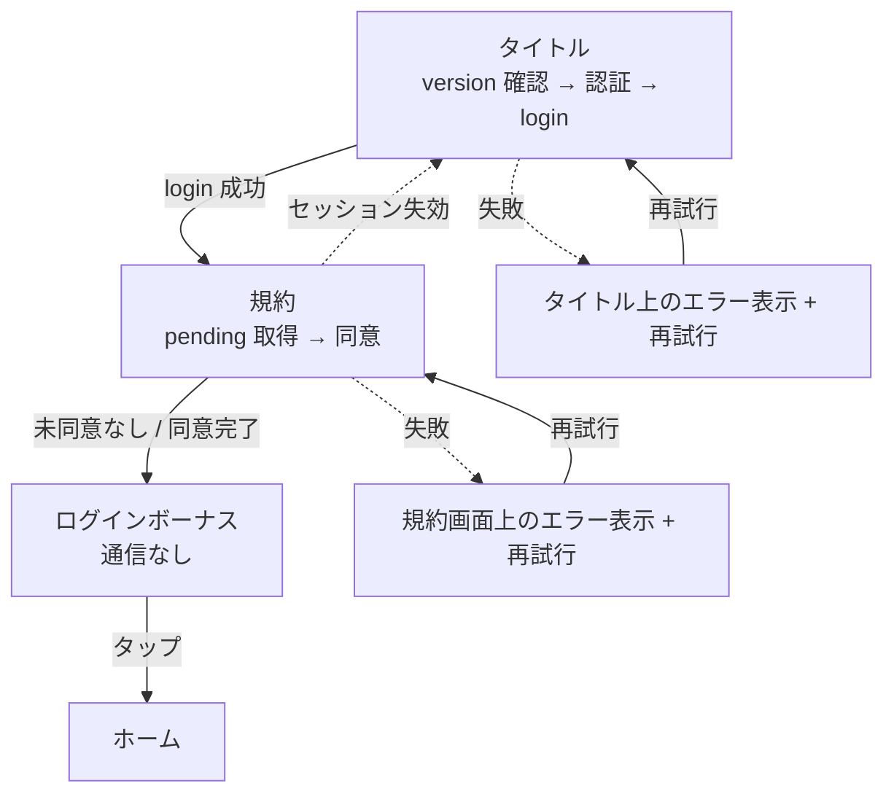

# タイトル〜ホーム クライアント設計

- 要件: `Nexus/docs/requirements/title-to-home.md`
- 全体設計: `Nexus/docs/design/title-to-home/overview.md`（食い違い表 D2〜D9）
- 決定: `Nexus/docs/adr/0001-master-distribution-host-in-client-config.md`（配信ホストはクライアントの設定値）
- サーバー設計（正）: `NexusMobileGameServer-Laravel/docs/design/title-to-home/{db,api,sequence}.md`

> 改訂履歴: クライアントのクリーンアーキテクチャ（presentation / domain / data の 3 層）+ 軽量 DDD 化（`.claude/architecture.md`）に合わせ、2 節（構成・変更ファイル）と各節のパス・クラス名を新構成に直した。**構造の変更**: マスターデータはコンテキストでなく共有モジュール `master_data/`（`contexts/` と同階層）に置く。 `ApiClient` のオートロード一本化 → `AppContext` が 1 つ生成（オートロード廃止）、`UserDataManager` を `auth` / `player` / `login` に分解、`ApiResult.kind` → 上位では `AppError.kind`。**API 呼び出し・エラー分類・冪等キー・refresh・確認手順の挙動は変えていない**。
>
> 改訂履歴（第 1 段の実装を受けた修正）: refresh の実行（`/auth/refresh_token` の送信とログアウト判断 D9）は `ApiClient`（core）が持ち、core の契約は token の供給（`refresh_token` / `save_tokens`）に絞った（3-1・3-5）。マスターの起動時は、保存済みの更新 DB が全部そろっていればそちらを開き、状態は `user://master_state.json` の 1 ファイルにした（5 節）。

> 改訂履歴（規約の閲覧）: 規約画面の「確認する」を、外部ブラウザから、アプリ内の閲覧画面（HTML を取得して `RichTextLabel` に描く。WebView は使わない）に変えた。`contexts/agreement` に `FetchAgreementDocumentUseCase`・`AgreementDocumentRepository`・`AgreementDocumentHttpRepository`（取得は認証なしの `ApiClient.download`）と、`presentation/terms_viewer/`（`terms_viewer_presenter.gd`・`html_to_bbcode.gd`）を足し、`ApiConfig.api_origin()` を足した。サーバーは規約の HTML を `api/public/legal/` に置き、`sys_agreement.url` を相対パスにする。e2e ドライバーに `--e2e-view-terms` を足した。

> 改訂履歴（第 3 段の実装を受けた修正）: 画面（presentation）・`SceneRouter`・`Toast`・オートロードの切り替え・旧構成の削除・e2e ドライバーまでを実装した。設計との差分: ① presenter が読む UseCase を足した（`login` の `GetLoginBonusesUseCase`、`player` の `GetPlayerIdUseCase`、`auth` の `GetAccessTokenUseCase`〔Reverb の認証に渡すトークン〕と `AuthenticateUseCase.is_new_user()`〔「新規登録中...」と「ログイン中...」の出し分け〕）。② エラー文言と表示は `core/presentation/{error_messages,error_view}.gd` に共通化。③ `Toast.connect_to_reverb(user_id, access_token)` は認証情報を引数で受ける（`UserDataManager` の廃止に伴う。ギルドの自動購読は新構成へ移るまで行わない）。④ 検証用に `ApiClient.debug_override`（login の偽の失敗）を足した。⑤ e2e ドライバーは `debug/e2e_driver.gd`（7-1 の `tests/e2e/` から変更）、引数は `--e2e-case=<名前>`（`--e2e=<名前>` も可）。⑥ タイトルとホームの「APIテスト」ボタンは外した（api_test は debug 専用で、直接開く）。⑦ 旧 `scenes/` `scripts/` は削除済み（2-3 の移行の進め方は完了）。

既存実装を**サーバー設計に合わせて直す**ための設計。サーバーが正で、食い違いはクライアントを合わせる。サーバーの仕様（項目・エラー）は複製せず、api.md を参照する。この文書はコードを変えない。変更するファイル・関数は、実コードを読んで特定した。

## 0. 現状の確認結果（設計の前提）

この表は改修前のコードの事実で、`場所` と本文のファイル名・クラス名は**旧パス**のまま（行き先は 2-1）。

| # | 確認したこと | 場所 |
| --- | --- | --- |
| a | `AuthService` はオートロードされているが、`title.gd` が `auth_service.gd` を `new()` して子に足し、そちらを使う。オートロード側は `api_test.gd`（`reset_device_id`）だけが使う | `project.godot`、`scenes/title/title.gd` |
| b | `ApiClient` はオートロードでなく、`title.gd`・`agreement.gd`（2 個）・`api_test.gd` がそれぞれ `new()` する。1 インスタンスは `HTTPRequest` 1 個と `_pending_request` 1 個しか持たず、同時 2 リクエストと並行 401 を扱えない | `api_client.gd` |
| c | API のベース URL が 3 か所にある（`api_client.gd` / `auth_service.gd` / `master_data_manager.gd` の `API_BASE_URL`）。配信ホスト `localhost:8091` は `master_data_manager.gd` の定数 | 各ファイル |
| d | `X-Master-Hash` は `ApiClient` の全リクエスト（`master_hash` が空でないとき）と `check_and_update` の version GET に付く。`AuthService` の sign_up / sign_in と refresh には付かない。**これが overview の U3 の答え** | `api_client.gd:_get_headers`、`master_data_manager.gd:check_and_update` |
| e | `X-Master-Update-Required` は `ApiClient` が成功（2xx）応答で見る。判定関数 `_has_master_update_required` は `scripts/tests/master_hash_test.gd` が直接呼ぶ | `api_client.gd` |
| f | `X-Unique-Request-Identifier` を送る箇所はコード全体に無い | grep |
| g | 401 の扱い: 401 を受け取り `_is_refreshing` でなければ refresh して再送する。再送がまた 401 だと、再び refresh する（**上限が無く、ループしうる**）。refresh 中の 2 つ目の 401 は「サーバーエラー: 401」の失敗になる。sign_up の署名不正 401 は `AuthService` 側で別に処理される | `api_client.gd:_on_request_completed` |
| h | refresh は `code != 200` を一律ログアウト扱いにする。299（10002/10003）は 200 でないので結果的にログアウトになる。ただし理由は区別していない。ログアウト後に出す画面が無い（`request_failed` を emit するだけ） | `_refresh_and_retry` |
| i | `check_and_update()` は先頭で `is_logged_in` を要求する。version GET は認証不要なのに、新規ユーザーは認証前に呼べない。title は認証後に呼んでいる（F8「ログイン前」と順序が違う）。`master_update_required` という body キーを読むが、サーバーは返さない（ヘッダーで知らせる） | `master_data_manager.gd` |
| j | 失敗系の表示: title は `status_label` に文字を出すだけで再試行手段が無い。login の通信失敗は**ホームへ進む**（D4）。agreement の取得失敗・業務エラーは**ログインボーナスへ進む**。503・429・409 の区別は無い | `title.gd`、`agreement.gd` |
| k | `UserDataManager.set_login_data` は unit / item / wallet / login_bonus だけ受ける（D2）。`.get("trx_unit_list", [])` は、キーが存在して値が null のとき null を返し、型付き引数（`Array`）で型エラーになる（D3） | `title.gd`、`user_data_manager.gd` |
| l | `login_bonus.gd` は `metadata` が Dictionary なら無条件に `grade` を表示する。サーバーの `metadata` は `{"is_paid": true}` などになりうる（`grade` があるとは限らない）ので、課金ボーナスでも「グレード1」と出る | `login_bonus.gd:_build_item_label` |
| m | 新規/既存の判定は `is_new_user() = not is_logged_in`（保存トークンの有無）。refresh 失敗のログアウトでトークンを消すと、次回は sign_up を呼ぶが、`device_id.save` は残る → サーバーは **10004（DEVICE_ALREADY_EXISTS）** を返す。現在はこの 10004 を処理していない（overview に無い、クライアント側の追加差分。下の D10） | `user_data_manager.gd`、`auth_service.gd` |
| n | `HTTPRequest.timeout` を設定していない（既定は無制限）。通信が詰まると「認証中...」のまま戻らない | 全 `HTTPRequest` |
| o | `ToastManager` の `ws://localhost:8080`（Reverb）と `broadcasting/auth` は対象外（要件）。ここでは変更しない。`.claude/api.md` が API のポートを 8080 と書いているのは誤り（API は :8090） | `toast_manager.gd` |

追加の食い違い: **D10（クライアント側）** refresh 失敗などでトークンだけ消えた後の sign_up が 10004 になる（上の m）。方針は 3 節 3-3。

## 1. 画面・シーン構成と遷移

### 1-1. 遷移

- 画面を増やさない。エラーは各画面の中に出す（タイトルと規約画面に、メッセージと「再試行」ボタンを足す）。
- **login が成功するまで規約・ログインボーナス・ホームへ進ませない**（要件 Q1 既定案。D4）。現行の `_on_login_failed` がホームへ進む処理は削除する。
- ログインボーナス画面は通信しない。`login` コンテキストの Repository が持つ `login_bonus_list` を（UseCase 経由で）表示し、タップでホームへ進む。ここへ来た時点で login は成功済みである。
- 規約の取得に失敗しても、規約・ログインボーナスを**飛ばさない**（現行の「スキップ」を廃止。仮置き）。

### 1-2. 画面ごとの状態

| 画面 | 状態 | 表示 | 次の動作 |
| --- | --- | --- | --- |
| タイトル | 進行中 | `status_label` に段階を文字で出す: 「マスターデータを確認中...」→（更新があれば）「マスターデータを更新中 (n/m)」→「認証中...」（既存は「ログイン中...」、新規は「新規登録中...」）→「ゲームデータを取得中...」→「ログイン成功!」 | 自動で次へ |
| タイトル | エラー | `status_label` にエラー文（4 節の表）、「再試行」ボタンを表示。進行中はボタンを隠す | ボタンで、**失敗した段階から**やり直す（成功済みの段階は繰り返さない）。ただし MASTER 段階が `FAILED` だったとき（`_master_failed`）は、**MASTER 段階から**やり直す（LOGIN など後ろの段階の失敗の再試行でも、MASTER が FAILED のときは MASTER から再実行する。冪等キーは保持する。初回は `master_hash` が空で `X-Master-Hash` が付かず、サーバーからの更新要求も来ないため、ここが再取得の唯一の手段） |
| タイトル | メンテナンス | 503 の `title` と `message`（あれば `end_at`）を表示、「再試行」 | 同上 |
| 規約 | 読み込み中 | 「読み込み中...」（現行は空白のまま。ラベルを足す） | pending 取得 |
| 規約 | 空 | 画面を見せず、そのままログインボーナスへ（要件: 無ければ見えない） | 自動 |
| 規約 | 一覧 | 規約カード + 「すべての規約に同意して続ける」 | 同意送信 |
| 規約 | 確認する | 規約カードの「確認する」で、規約の閲覧画面（下の「規約の閲覧」）を規約画面の上に重ねて開く（以前は `OS.shell_open` で外部ブラウザを開いていた）。開いている間は、もう 1 つ開かない | 閲覧画面の「閉じる」で規約画面に戻る（遷移ではない） |
| 規約の閲覧 | 読み込み中 | 規約名（タイトル + 版）と「読み込み中...」。`sys_agreement.url` を取得する（`FetchAgreementDocumentUseCase`）。絶対 URL（http / https）はそのまま、`/` 始まりの相対パスは API の origin（`ApiConfig.api_origin()`）に付ける。それ以外は通信せず失敗 | 自動 |
| 規約の閲覧 | 表示 | 取得した HTML のサブセット（`h1`〜`h3` `p` `br` `ul` `ol` `li` `strong` `b` `em` `i` `a`〔http / https のみ〕`hr`）を BBCode に変換し、スクロールできる `RichTextLabel` に描く。未対応のタグは文字だけ残し、`script` `style` `head` `title` は捨てる。本文の `[` `]` はエスケープする。リンクは http / https だけ外部ブラウザで開く | 「閉じる」 |
| 規約の閲覧 | エラー | 通信断・タイムアウト・HTTP 200 以外・本文が空・URL 不正・表示できる内容が無い、のいずれか。エラー文と「再試行」「ブラウザで開く」（元の URL を外部ブラウザで開く） | 再試行は取得からやり直す（二重取得はしない） |
| 規約 | 送信中 | ボタンを無効化、「送信中...」 | 規約ごとに 1 件ずつ送る |
| 規約 | エラー | エラー文と「再試行」。pending 取得失敗なら取得から、consent 失敗なら**失敗した規約から**やり直す | 再試行 |
| ログインボーナス | あり | 受取内容（種別・ID・数量）+「タップして続ける」 | タップ → ホーム |
| ログインボーナス | なし（空） | 「本日のログインボーナスは受け取り済みです」 | タップ → ホーム |
| ホーム | 表示 | プレイヤー ID（`user_id`）。ホームの中身は対象外 | - |

### 1-3. エラーの分類と表示・動線（D5）

HTTP ステータスで分類する。401・429・503（メンテ）には `error_code` が無い。文言は Q3 の既定案（汎用 + 再試行）に従い、メンテナンスだけサーバーの `title` / `message` を使う。

| 種別（`AppError.kind`） | 条件 | 表示（既定案） | 動線 |
| --- | --- | --- | --- |
| `NETWORK` | `HTTPRequest` の result が成功以外（接続不可・タイムアウト・TLS 等） | 「通信できませんでした。電波の良い場所でお試しください」 | 再試行 |
| `MAINTENANCE` | HTTP 503 で本文に `error_code` が無い | サーバーの `title` と `message`（あれば終了予定 `end_at`）。無ければ「ただいまメンテナンス中です」 | 再試行（メンテ中は押しても同じ。押した結果を再表示する） |
| `SERVER_BUSY` | HTTP 503 で `error_code` = 50300 | 「しばらくしてからお試しください」 | 再試行 |
| `RATE_LIMITED` | HTTP 429 | 「アクセスが集中しています。しばらくしてからお試しください」。`retry_after`（秒）があれば「あと約 N 秒後に」 | 再試行ボタンを `retry_after` 秒の間無効にする（無ければ即可）。表示は**固定文**（「あと約 N 秒後に」の N は表示時点の値で、カウントダウンはしない。仮置き） |
| `CONFLICT` | HTTP 409（40900） | 「処理中です。しばらくしてからお試しください」 | 再試行。**同じ冪等キーで**送る（3 節 3-4） |
| `BUSINESS` | HTTP 299 | 「エラーが発生しました (コード: N)」。`message` は本番でマスクされるので補助表示 | 再試行（**新しい冪等キー**）。10002・10004・24002・24001 は画面に出さずに処理する（3 節） |
| `SESSION_EXPIRED` | refresh が失敗してログアウトした | 「ログイン情報が無効になりました。最初からやり直します」 | タイトルへ戻る（規約画面で起きたとき）。タイトル内で起きたら認証からやり直す |
| `VALIDATION` | HTTP 422 | 「エラーが発生しました (422)」 | 再試行 |
| `SERVER_ERROR` | その他の非 2xx（500 など） | 「サーバーでエラーが発生しました (コード: N)」 | 再試行 |
| `PARSE` | JSON が読めない | 「サーバーの応答を読めませんでした」 | 再試行 |
| 署名不正 | sign_up の 401（本文の `error` が `INVALID_SIGNATURE` など） | 「端末の確認に失敗しました」。`REQUEST_EXPIRED`（時刻ずれ）は「端末の時刻を確認してください」 | 再試行（nonce は毎回作り直す） |

- `retry_after` はボディの値を使う（`Retry-After` ヘッダーも付くが、ヘッダーの読み取りは不要）。
- 再試行ボタンは**押した結果をそのまま再表示する**。自動で繰り返さない（レート制限を悪化させない。自動で再送するのは 401 の refresh 後の 1 回だけ）。

## 2. 構成と変更するファイル

構成の方針は `.claude/architecture.md`（クリーンアーキテクチャ + 軽量 DDD）。この機能の実装は、関係するファイルを**新構成へ移しながら**行う。0 節の「場所」は改修前の旧パスのまま。

### 2-1. 追加・変更するファイル

| 区分 | 新しい場所 | 旧 / 変更 |
| --- | --- | --- |
| 追加 | `core/data/config/api_config.gd`（`class_name ApiConfig`） | API ベース URL と配信ホストを 1 か所で返す。値の出どころ: ① 環境変数 `NEXUS_API_BASE_URL` / `NEXUS_MASTER_BASE_URL`、② `project.godot` の `[nexus]` セクション（`api_base_url` / `master_base_url`。既定 `http://localhost:8090/api` と `http://localhost:8091`）。①が②を上書きする（検証時に向き先を変えるため）。仮置き |
| 追加 | `core/data/http/api_result.gd`（`class_name ApiResult`） | 通信結果の値。`ok`、`kind`（1-3 の種別の enum）、`http_status`、`error_code`（無ければ -1）、`message`、`data`（Dictionary）、`headers`、`retry_after`、`maintenance`（503 の title / message / end_at）。`core/data` の内部の型で、API repository が `AppError`（下）に直して上位へ渡す |
| 追加 | `core/domain/app_error.gd`（`AppError`）、`core/domain/result.gd`（`Result`） | 失敗の種別（1-3 の enum）・`error_code`・`message`・`retry_after`・メンテナンス情報を持つ値と、成功/失敗の基底。presenter・UseCase はこれで失敗を扱い、`ApiResult` を知らない |
| 追加 | `core/domain/json_reader.gd`（`class_name JsonReader`） | null と欠落を同一に扱う読み取り。**最小で始める**: `get_array(d, key)`（一覧 7 つ用）と `get_dict(d, key)`（`sys_player` 用）の 2 関数だけ。文字列・数値の読み取りは、必要になった時点で足す。使うのは各コンテキストの `data/api` の応答変換だけ |
| 追加 | `core/domain/event_bus.gd`（オートロード `EventBus`。**`class_name` を付けない**） | `session_expired`、`master_update_required` のシグナル。`ApiClient` が自分のシグナルとして出し、`AppContext` が `EventBus` に中継する（`core/data` はオートロード名を参照しない）。`session_expired` の受け手は `auth` / `player` / `login`、`master_update_required` の受け手は `master_data` だけ（マスターは端末のもので `session_expired` では消さない）。循環を避けるため（2-4） |
| 変更（移動） | `scripts/services/api_client.gd` → `core/data/http/api_client.gd` | **`AppContext` が 1 つ生成して Repository 実装に渡す**（オートロードにはしない）。シグナル（`request_completed` など）を廃し、`await api_client.request(method, endpoint, body, options) -> ApiResult` にする。`options`: `auth`（既定 true）、`idempotency_key`、`extra_headers`。1 呼び出しごとに `HTTPRequest` を作って破棄する（同時実行可）。`timeout = 15` 秒。分類・refresh・`X-Master-*` はここに閉じ込める（3 節）。トークンと `master_hash` は core が定義した契約（`core/domain/`）経由で受け取り、contexts を参照しない |
| 追加 | `contexts/auth/domain/use_cases/authenticate_use_case.gd`（`AuthenticateUseCase`） | 旧 `AuthService.authenticate()` の振り分け（sign_in / sign_up の切り替え。3-3）。`await handle() -> Result`（成否だけなので専用の結果型は作らない）。成功でトークンを保存する |
| 追加 | `contexts/auth/domain/repositories/auth_repository.gd`（契約）、`contexts/auth/data/repositories/auth_api_repository.gd` | 旧 `auth_service.gd` の通信部分（契約 `auth_repository` はテストで偽物に差し替えるために作る。sign_up / sign_in の応答は項目が少ないので専用の `*_response.gd` を作らず、data の中で取り出す）。refresh（`/auth/refresh_token`）の送信は `ApiClient` が行うので、ここには持たない。独自の `HTTPRequest` / `BASE_URL` / シグナルを廃し、`api_client.request(..., {auth=false, extra_headers=署名})` を使う。署名関数（`_create_signed_headers` 等）と `reset_device_id()` はここ（または `data/local/` の device_id 保存）に残す。`CLIENT_SECRET` の保護は別機能（Q4）で、ここでは触らない |
| 追加 | `contexts/auth/data/repositories/local_auth_token_repository.gd`（core の契約を実装する。別の契約は作らない） | 旧 `UserDataManager` のトークン部分（`auth_token` / `refresh_token` の保持・保存・`update_tokens`）、`is_new_user()` の根拠。core の契約 `ApiAuthProvider`（`access_token()` / `refresh_token()` / `save_tokens()`）を実装し、`ApiClient` がトークンの読み出しと refresh 後の保存に使う。`clear_session()` のトークン部分は `EventBus.session_expired` の受け手として行う |
| 変更（分解） | `scripts/managers/user_data_manager.gd` → `contexts/player/`（所持データ）・`contexts/login/`（ログインボーナス） | `trx_diamond_list` `trx_equipment_list` `trx_stamina_list` を追加。取り込みは `player/domain/use_cases/apply_login_data_use_case.gd`（login の応答から `sys_player`・trx 6 種を受ける）で、保持は `player/data/repositories/local_player_repository.gd`（メモリのみ）。`login_bonus_list` は `login/data/repositories/local_login_bonus_repository.gd`。**D9 のログアウト扱いは `logout()` ではなく `EventBus.session_expired`**: `auth`（トークンと保存の `user_data` を消す）と `player`（`user_data`・trx 一覧を空にする）・`login`（`login_bonus_list` を空にする）が受け手になる（`AppContext` が登録）。**`master_hash` と `master_deploy_id` は `master_data` の持ち物で、`session_expired` では消さない**（マスターの DB・ハッシュ〔`user://master/`、`master_hashes.json`〕は端末のものでアカウントに依存しないため）。旧 `logout()`（全部消す）は e2e の `--e2e-reset` 用に、デバッグ専用で残す |
| 追加 | `contexts/login/domain/use_cases/login_use_case.gd`、`login/domain/repositories/login_repository.gd`、`login/data/repositories/login_api_repository.gd`、`login/data/api/login_response.gd` | `POST /auth/login`。`await handle(idempotency_key) -> Result`。応答を `login_response`（9 項目。`JsonReader` で変換、D3）にし、`player` の公開 UseCase に渡し、ログインボーナスを自コンテキストの Repository に保持する |
| 変更（移動） | `scripts/managers/master_data_manager.gd` ほか → `master_data/`（`contexts/` の下ではない共有モジュール） | `master_data/domain/use_cases/check_master_data_use_case.gd`（`check_and_update()` を移す）、`master_data/data/repositories/master_data_api_repository.gd`（version GET とダウンロード）、`master_data/data/repositories/local_master_data_repository.gd`（SQLite・ハッシュ保存）。`mst_*` の Repository・モデルも `master_data/` に移す（`master_data/domain/` に読み取りモデルと契約、`master_data/data/` に実装）。`API_BASE_URL` / `MASTER_DATA_BASE_URL` は `ApiConfig` に置き換える。先頭の `is_logged_in` ガードと、body の `master_update_required` の読み取りを削除。戻り値を bool から `CheckMasterDataResult`（5 節）にする。version GET は `api_client.request("GET", "/auth/version?deploy_version=N", {}, {auth=false})` |
| 変更（移動） | `scenes/title/title.gd` `title.tscn` → `contexts/auth/presentation/title/title_presenter.gd` `title.tscn` | 認証〜login の段階制御を `await` の直列に書き直す（3 節 3-2）。呼ぶのは UseCase だけ（`check_master_data_use_case` / `authenticate_use_case` / `login_use_case`）。`AuthService` / `ApiClient` の `new()` と接続コードを削除。`_on_login_failed` のホーム遷移を削除。`RetryButton` を追加（表示/非表示はコード）。`user_data_loaded` の接続処理（オートロードの `_ready` は既に終わっているので意味が無い）を、単に `_run_startup()` を呼ぶ形にする |
| 追加・移動 | `contexts/agreement/` | `domain/use_cases/fetch_pending_agreements_use_case.gd`、`consent_agreement_use_case.gd`、`data/repositories/agreement_api_repository.gd`、`domain/entities/sys_agreement.gd`（旧 `scripts/models/sys/sys_agreement.gd`。変更なし）。`scenes/agreement/agreement.gd` `agreement.tscn` → `presentation/agreement/agreement_presenter.gd` `agreement.tscn`: `ApiClient` 2 個の `new()` を廃し、UseCase を `await` で使う。失敗時のスキップを廃止し、`StatusLabel` と `RetryButton` を足す。consent に冪等キーを付ける（3 節） |
| 変更（移動） | `scenes/login_bonus/login_bonus.gd` → `contexts/login/presentation/login_bonus/login_bonus_presenter.gd` | 表示内容を `login` の Repository（UseCase 経由）から受ける。`metadata` の `grade` 表示を「`grade` キーがあるときだけ」にする（0 節 l）。他は変更なし |
| 変更（移動） | `scenes/home/` → `contexts/player/presentation/home/` | プレイヤー ID は `player` の UseCase 経由で受ける。内容は変えない |
| 変更（移動） | `scenes/api_test/api_test.gd` → `debug/`（エクスポート除外） | `ApiClient` の `new()` を廃し、`AppContext` の取得メソッドを使う形に合わせる（デバッグ画面。シグナルを `await` に置き換えるだけ）。機能は変えない |
| 変更（移動） | `scripts/tests/master_hash_test.gd` → `tests/unit/core/data/http/api_client_test.gd`（仮置き） | `_has_master_update_required` は `api_client.gd` に残す（静的関数 `static func has_master_update_required` に変えるなら `new()` を外す）。テストの期待は変えない |
| 変更（移動） | `scripts/managers/scene_manager.gd` → `app/scene_router.gd`（オートロード `SceneRouter`。`class_name` なし） | 遷移先のパスだけ新構成に合わせる。ほかは変えない |
| 変更（移動） | `scripts/managers/toast_manager.gd` → `core/presentation/toast.gd`（オートロード `Toast`。`class_name` なし）（対象外） | 移動のみ。`ws://localhost:8080`（Reverb）と `broadcasting/auth` には触れない |
| 追加 | `app/app_context.gd`（オートロード `AppContext`） | 依存の組み立て（**`class_name` を付けない**）。`ApiClient`、各 Repository 実装、UseCase を生成し、presenter へ渡す。`EventBus` の受け手を登録する。**`_ready` では他のオートロードを呼ばない**（購読登録のみ） |
| 変更 | `project.godot` | `[autoload]` を `EventBus`・`AppContext`・`SceneRouter`・`Toast` に整理（順序はこのとおり）。`[nexus]` セクション（上記の URL）。検証用ドライバー（7 節）を最後に追加 |
| 変更しない | `scripts/models/**`・`scripts/repositories/**` のうち、この機能で触らないもの（`mst_*` 以外の `trx_*` など） | 旧構成のまま。機能単位で移す（architecture.md 8 節） |

旧 `scripts/models/**`・`scripts/repositories/**`（`mst_*`）は `master_data/` へ移すので、実際に「変更しない」のは `trx_*` モデル（`player` で使う機能のときに移す）。

依存の向き: `presentation → domain ← data`。`master_data/` は `contexts/` と同階層の共有モジュールで、`contexts/*` → `master_data/domain`（読み取りのみ）は許可、`master_data` → `contexts/*` は禁止、`master_data` は `core` を使える（architecture.md 2-1）。。**`app` の参照**: presentation だけは、オートロード名 `AppContext`（UseCase の受け取り）・`SceneRouter`・`Toast`・`EventBus` を参照してよい。`res://app/` のパス参照（`preload` / `load`）は不可。domain / data は `app` を参照しない。（data が domain の契約を実装し、presentation は data を参照しない）。presenter は他コンテキストの domain の公開 UseCase だけを呼ぶ（title が `master_data` / `auth` / `login` の UseCase を呼ぶ）。`ApiClient` が token（`auth`）と `master_hash`（`master_data`）を必要とし、`MasterDataManager` 相当が `ApiClient` を呼ぶ**循環**がある。これを、core の契約（トークン・`master_hash` の供給）と `EventBus` で解く: `ApiClient` は契約を通して値を受け取り、`master_update_required` は `EventBus` のシグナルを emit するだけにし、`master_data` が `AppContext` の登録で受ける（直接参照しない）。

### 2-2. オートロードへの影響

| 名前 | 変更 | 備考 |
| --- | --- | --- |
| `UserDataManager` | **廃止**（`auth` / `player` / `login` の Repository に分解） | 移行の途中は旧オートロードを残してよい（architecture.md 8 節。状態の持ち主は 1 つ。残る間は旧側も `session_expired` を受ける移行用転送を置く） |
| `SceneManager` | `SceneRouter` に改名・移動 | |
| `ApiClient` | オートロードにしない。`AppContext` が生成 | ほかのオートロードの `_ready` で通信しないので順序は影響しない |
| `AuthService` | `AuthenticateUseCase` と `AuthApiRepository` に分解（オートロード廃止） | title の `new()` との二重は解消 |
| `MasterDataManager` | `master_data/` の UseCase と Repository に分解（オートロード廃止） | `_ready` で同梱 DB を開く処理は `local_master_data_repository` の初期化へ（変えない） |
| `ToastManager` | `Toast` に改名・移動 | 失敗通知（5 節）に `show_toast` を再利用する（WebSocket 未接続でも動く） |
| `EventBus`・`AppContext` | **追加**（`class_name` なし） | `EventBus` が最初、次に `AppContext`。`AppContext._ready` は他のオートロードを呼ばない |

### 2-3. 移行の進め方

- 最初の移行は **core・`master_data/` と関係するコンテキスト（auth / login / player / agreement）を一括で**行う（`ApiClient` がトークンと `master_hash` の契約を要するため。「コンテキストの一部だけ移した状態を残さない」ルールの例外。architecture.md 8 節）。
- （移行中の取り決め。完了したので不要）旧 `UserDataManager` が残る間は、旧側も `EventBus.session_expired` を受ける移行用転送を置く（新 `ApiClient` の refresh 失敗で旧状態も空にするため）。
- **第 3 段で実施済み**: 旧構成（`scripts/` の `mst_*` モデル・Repository）を削除した後、衝突回避で付けた `master_data/` の `Master*`（`MasterUnit` など）を `Mst*`（`MstUnit`・`MstUnitRepository`・`LocalMstUnitRepository` など）に改名した。同じく規約の `PendingAgreement` も `SysAgreement` に戻した（`git mv` で `.gd` と `.gd.uid` を一緒に動かした）。
- `api_test` と e2e ドライバーは debug 用の置き場（`debug/` または `tests/e2e/`）に置き、エクスポート除外か debug ビルド専用のオートロードにする。`tests/`・`debug/` は `app` を参照してよい。

### 2-4. 二重定義・複数生成の整理の方針（まとめ）

- 認証は **`AuthenticateUseCase` に一本化**する。`title` の `preload(...).new()` は削除する。
- `ApiClient` は **`AppContext` が作る 1 インスタンスに一本化**する。画面ごとの `new()` は削除する。「同時実行」と「並行 401」は、リクエストごとの `HTTPRequest` と、refresh を 1 本にまとめる仕組み（3-5）で解く。
- ベース URL は `ApiConfig` の 1 か所。旧 `auth_service.gd` の `BASE_URL`・`api_client.gd` の `BASE_URL`・`master_data_manager.gd` の 2 定数を削除する。
- 配信ホスト（ADR 0001）は `ApiConfig.master_base_url()`。`master_data_api_repository` のダウンロードで、version の `url` が `/` から始まるときに前置する（現行の動作と同じ。定数だけが設定値に変わる）。`url` が `http` で始まる絶対 URL のときはそのまま使う（将来、サーバーが基準 URL を返す案に切り替えたときの互換）。

## 3. API 呼び出し

### 3-1. 一覧（対応先はサーバー api.md の節）

| API（api.md） | 呼ぶタイミング・呼び元 | Post / Query | 冪等キー | 失敗時の扱い |
| --- | --- | --- | --- | --- |
| GET `/auth/version`（2 節） | 起動直後、認証の**前**。`CheckMasterDataUseCase`（`master_data/domain/use_cases/`）が呼ぶ（title の最初の段階） | query `deploy_version`（保存済みの `master_deploy_id`）。`X-Master-Hash` | なし（GET・認証なし） | 失敗しても**止めない**。同梱（または前回取得済み）の DB で続行し、通知する（5 節） |
| POST `/auth/sign_up`（3 節） | 保存トークンが無いとき。または sign_in が 10002 のとき | `device_id`、`device_info{os, os_version, model, app_version}`、署名ヘッダー 3 種 | なし（認証前） | 10004 → sign_in に切り替え（3-3）。他は 1-3 の表 |
| POST `/auth/sign_in`（4 節） | 保存トークンがあるとき。または sign_up が 10004 のとき | `device_id`、`device_info`（**4 項目すべて必須**、`app_version` は 20 文字以内） | なし | 10002 → sign_up に切り替え（3-3）。他は 1-3 の表 |
| POST `/auth/refresh_token`（5 節） | `ApiClient` が認証付きリクエストで 401 を受けたとき（自動。refresh の送信と失敗の判断は `ApiClient`（core）が持つ。契約は token の供給 `ApiAuthProvider` に絞り、`auth` の `local_auth_token_repository` が実装する） | `refresh_token`（64 桁） | なし | 299 の 10002 / 10003、200 以外、解析失敗はすべてログアウト扱い（3-5） |
| POST `/auth/login`（6 節） | 認証成功の直後。title が 1 回 | ボディなし（`{}`） | **付ける** | 1-3 の表。成功するまで次へ進まない。成功時は 9 項目を保持（4 節） |
| POST `/agreement/pending`（7 節） | 規約画面の `_ready` | なし | なし（list 系なので冪等キーは付けない） | 1-3 の表。スキップしない |
| POST `/agreement/consent`（8 節） | 「すべての規約に同意して続ける」。規約ごとに 1 件ずつ、直列 | `sys_agreement_id` | **付ける（規約ごとに 1 キー）** | 24002 は成功扱い。24001 は pending を取り直す。他は 1-3 の表 |
| POST `/auth/version`（9 節） | 使わない（GET を使う） | - | - | - |

`X-Unique-Request-Identifier` を付けないとサーバーは冪等チェックを素通しする（二重送信は login が「ログインボーナス空」、consent が 24002 になる）。**付けることを達成条件にする**（D6）。

### 3-2. タイトルの段階（title.gd）

`await` の直列で書き、失敗した段階を覚えて再試行できるようにする。

presenter（`title_presenter`）は UseCase を `AppContext` から受け取り、遷移は `SceneRouter` を呼ぶ（presentation にだけ許す、オートロード名での `app` の参照。`res://app/` の `preload` / `load` はしない。2-1）。

| 段階 | 処理 | 失敗時 |
| --- | --- | --- |
| 1 `MASTER` | `await check_master_data_use_case.handle()` | 結果が失敗でも次へ（通知だけ。5 節）。`_master_failed` を立てる |
| 2 `AUTH` | `await authenticate_use_case.handle()` → 成功で UseCase がトークンを保存（`local_auth_token_repository`） | エラー表示・再試行（この段階から） |
| 3 `LOGIN` | `await login_use_case.handle(_login_key)`（内部で `POST /auth/login`、冪等キー付き）→ 成功で `player` / `login` の Repository に 9 項目を保持 | エラー表示・再試行（この段階から。認証は繰り返さない） |
| 4 完了 | `Toast.connect_to_reverb()`（現行のまま。対象外） → 「ログイン成功!」→ `SceneRouter.goto_agreement()` | - |

- `SESSION_EXPIRED`（LOGIN 中に refresh が失敗しログアウトされた）は、2 の AUTH からやり直す。AUTH でのやり直しは 10004 の切り替え（3-3）が効く。
- 起動の 0.5 秒待ち（`create_timer(0.5)`）は残してよい（タイトルを見せる演出）。

### 3-3. sign_in / sign_up の振り分け（D10 を含む）

`AuthenticateUseCase.handle()` の規則。

1. 保存トークンあり（`is_new_user()` が偽）→ sign_in。299 の **10002** → sign_up（署名つき）に切り替え（現行どおり。無限ループ防止に、切り替えは 1 回だけ）。
2. 保存トークンなし → sign_up。299 の **10004** → sign_in に切り替え（**追加**。1 回だけ）。device_id は保存済みの値を使うので、同じ利用者としてログインできる（要件 F1）。
3. 切り替えは**1 回だけ**で打ち切る。sign_up が 10004 → sign_in が 10002 を返す（サーバーの状態が矛盾している）場合も、それ以上切り替えず、その 299 を `BUSINESS` として返して表示する（1-3 の表）。他の失敗も同様にその結果を返す。

overview の「保存済みトークンの有無で最初に呼ぶ API を決める」は変えない。D10 は、その規則の穴を 10004 の切り替えで塞ぐ（overview の修正が要るかは未解決点 1）。署名は sign_up のたびに timestamp と nonce を作り直す。`device_info.app_version` は 20 文字以内にそろえる（現行 `"1.0.0"`）。

### 3-4. 冪等キー（D6）

- 形式: UUID v4（`Crypto.generate_random_bytes(16)` から作る。現行の `AuthService._generate_uuid`（旧。移行後は `auth/data/` 側） は `randi()` で、暗号論的でない。`device_id` 用はそのまま）。キーは `ApiClient` の呼び出しに `idempotency_key` で渡す。付けるのは `X-Unique-Request-Identifier` ヘッダー。
- 付ける API: **login と consent**（認証付き POST）。GET・認証前の API には付けない。
- **キーの寿命は「ひとつの操作」**。操作を呼び出し元（title / agreement）が持つ。
  - login: タイトルの LOGIN 段階に入るときに作り、`_login_key` に保持する。
  - consent: `sys_agreement_id` ごとに作り、辞書で保持する。
- **再送時にキーを再利用するか**

| 直前の結果 | サーバーの状態 | キー |
| --- | --- | --- |
| `NETWORK`（応答が来ていない） | 処理済みかもしれない。済みなら HIT で保存済み 200 が返る | **再利用** |
| 401 → refresh 後の再送（`ApiClient` 内部） | 401 は冪等より手前で返り、保存されない | **再利用** |
| `CONFLICT`（409）・`SERVER_BUSY`・`MAINTENANCE`・`SERVER_ERROR`（非 2xx は保存されず、処理中の印も消える。429 は login・consent には throttle が無いので起きない。sign_up / sign_in / refresh の再試行は冪等キーを使わない） | 未処理、または処理中 | **再利用**（処理済みなら HIT） |
| `BUSINESS`（299） | **業務エラーも保存される**（再送すると同じエラーが返る） | **作り直す** |
| 成功 | 完了 | 次の操作では新しいキー（再利用しない） |

- 画面を作り直す（タイトルへ戻る）ときは、キーも作り直す。
- サーバーはキーを 24 時間保持し、キーの形式は検証しない。

### 3-5. HTTP の分類・refresh・X-Master（ApiClient の責務）

**分類（`ApiResult.kind`。`auth` などの API repository が `AppError.kind` に直して上位へ渡す）**: 判定の順は次のとおり。

1. `HTTPRequest` の result が成功でない → `NETWORK`。
2. 401 → 認証付きなら 3-5 の refresh へ。認証なし（sign_up）なら署名不正（本文の `error` で文言を分ける）。
3. 429 → `RATE_LIMITED`（本文の `retry_after`）。
4. 503 → 本文に `error_code` があり 50300 なら `SERVER_BUSY`、無ければ `MAINTENANCE`（`title` / `message` / `start_at` / `end_at` を `maintenance` に格納）。
5. 409 → `CONFLICT`。
6. 299 → `BUSINESS`（`error_code`・`message`）。
7. 422 → `VALIDATION`。他の 2xx 以外 → `SERVER_ERROR`（本文に `error_code` があれば添える）。
8. 2xx で本文が JSON として読めない → `PARSE`。

401・429・503（メンテ）は `error_code` を持たない。299 だけが `error_code` を見る（現行の「299 だけ見る」と同じで、そこに 429 / 503 / 409 の分類を足す）。

- HTTP 2xx（299 を除く）の本文が空の配列 `[]`（または空本文）は、`options.allow_empty_body = true` のときだけ空の辞書として成功扱いにする（**consent のみ指定**。サーバーは項目の無い成功を `[]` で返す）。既定では `PARSE`（プロキシなどの空の 200 を login が成功と誤認しないため）。要素のある配列は常に `PARSE`。299 の本文は従来どおり辞書が必要。

**X-Master-Hash**: `ApiClient` は**すべてのリクエスト**に、`master_data/` の保持する `master_hash`（core の契約経由）が空でなければ付ける（現行は AuthService の sign_up / sign_in と refresh に付いていなかったが、統一する。サーバーは全 API で受け付ける）。サーバーは HTTP 200 の応答にだけ `X-Master-Update-Required: true` を付ける（299・4xx・5xx には付かない）。

**X-Master-Update-Required の扱い**: 200 の応答にあれば `ApiClient` のシグナル `master_update_required`（`AppContext` が `EventBus` へ中継）を出して**待たずに結果を返す**。`master_data/` がシグナルを受け（`AppContext` が登録）、`CheckMasterDataUseCase` を**裏で 1 本だけ**実行する（実行中フラグ。実行中の通知は無視）。起動時（タイトルの MASTER 段階）に更新済みなので、起動直後に付くのは起動中にサーバーが更新されたときだけ。version GET 自体の応答に付いた場合は無視する（更新判定は本文の `needs_update` で足りる）。更新が終わると DB を切り替える（`master_data_loaded`）。

**自動トークンリフレッシュ（F6、D9）**:

- 認証付きリクエストが 401 → refresh → **同じリクエストを 1 回だけ**再送する。再送がまた 401 なら refresh せずに `SESSION_EXPIRED`（現行の無限ループを止める）。
- **並行リクエスト**: refresh は常に 1 本。進行中は、後から 401 を受けたリクエストはその完了を `await` で待ち、終わったら（成功なら）自分の再送に進む。失敗ならまとめて `SESSION_EXPIRED`。`_pending_request` は廃止し、再送に必要な値（メソッド・エンドポイント・ボディ・冪等キー）はリクエスト呼び出しのローカルで保持する。
- **失敗の扱い（D9）**: refresh が次のいずれかなら**ログアウト扱い**にする: 保存の refresh_token が空、299 の 10003（無効・期限切れ・使用済み）、299 の 10002（プレイヤー／端末なし）、HTTP 200 以外、本文が解析できない、`token.access_token` が空。`EventBus.session_expired` を出して `auth` / `player` / `login` が状態を空にし（2-1。マスター情報は残す）、`SESSION_EXPIRED` を返す。呼び出し元の画面が、規約画面ならタイトルへ戻り、タイトルなら AUTH 段階から再開する。
- ネットワーク断・429・503 など「refresh を試せなかっただけ」のときは**ログアウトしない**（`NETWORK` などをそのまま返す）。refresh は 429（15 分 10 回）の対象で、同じトークンの同時送信は片方が 10003 になりうる（api.md 5 節）。並行 401 を 1 本にまとめるのはこのため。
- refresh のレスポンスには `sys_player` が無い。トークンだけを、契約の `save_tokens()` で保存する（`refresh_token` が応答に無ければ手元の値を維持する）。
- refresh の実行は `ApiClient`（core）が持つ（`/auth/refresh_token` の送信、上の失敗の分類、`session_expired` の発行）。契約（`ApiAuthProvider`）は token の供給（`access_token()` / `refresh_token()` / `save_tokens()`）に絞る。`auth` は契約の実装とセッション破棄の受け手だけで、refresh の通信を持たない。
- refresh 要求には `Authorization` を付けない（サーバーはアクセストークンを見ない）。

## 4. Response からモデルへの対応

**方針（最小の変更）**: 型付きモデルは導入せず、**Dictionary のまま**保持する。理由: ホーム以降の画面が trx 一覧を使うかが未定で、既存の `scripts/models/trx/*.gd` はサーバーの項目名と合っていない（例 `TrxUnit` は `id` / `sys_player_id` を読むが、login は `trx_unit_id` で `sys_player_id` を返さない。`SysPlayer` は `vip_point` / `total_paid_amount` を持たない）。モデルの作り直しは、一覧を使う画面を作る機能で行う。この機能で型付きにするのは、既存の `SysAgreement.from_dict` だけ（変更なし）。

### login の保持先（D2）

| Response の項目（api.md 6 節） | 保持先（`player` / `login` の Repository） | 現状 | 備考 |
| --- | --- | --- | --- |
| `sys_player` | `player` の Repository の `user_data`（Dictionary）。`my_id` から `user_id` | 保持済み | 非 null。`total_paid_amount` は文字列 `"0.00"`、`vip_point` は整数 |
| `trx_unit_list` | `trx_unit_list: Array` | 保持済み | |
| `trx_item_list` | `trx_item_list` | 保持済み | |
| `trx_wallet_list` | `trx_wallet_list` | 保持済み | |
| `trx_diamond_list` | `trx_diamond_list`（**追加**） | 捨てている | 要素: `platform` `paid_amount` `free_amount` `is_delete` |
| `trx_equipment_list` | `trx_equipment_list`（**追加**） | 捨てている | 要素: `trx_equipment_id` `mst_equipment_id` `grade` `level` `level_exp` `is_delete` |
| `trx_stamina_list` | `trx_stamina_list`（**追加**） | 捨てている | 要素: `type` `current_stamina` `recovery_rate_multiplier`（文字列 `"1.00"`）`last_recovery_at` `is_delete` |
| `login_bonus_list` | `login_bonus_list` | 保持済み | 6 キー常にあり。`expire_at` は常に null、`metadata` は null 可 |
| `login_bonus_calendar`・`vip_login_bonus_calendar` | `login` の Repository（`LoginBonusRepository.replace_calendars`）。段の進捗だけ | login-bonus-calendar で追加 | キー欠落・null は「その段なし」。項目・仕様は Nexus の `docs/design/login-bonus-calendar/overview.md`、クライアントの扱いは `docs/design/login-bonus-calendar/client_design.md` |

- 応答全体は `login_response`（`data/api`。`RefCounted`。`Resource` は `.tres` / `@export` を使うものだけで、ここは使わない）で型付きオブジェクトにするが、一覧の**要素は Dictionary のまま**保持する（下の方針）。移行時の扱いは 2-3。
- 永続化しない（セッションのメモリのみ）。`local_player_repository` はメモリのみで、保存の対象に足さない（現行の `save_user_data` と同じ扱い）。
- Godot は JSON の数値を float で持つ。数量・ID を整数として使う側が `int()` で変換する（取り込み時は元のまま保持する）。

### null と欠落（D3）

- 取り込みは `JsonReader` を通す。**キーが無い場合と値が null の場合を同じ**に扱い、既定値（配列は `[]`、Dictionary は `{}`）を返す（`JsonReader` は `get_array` と `get_dict` の 2 関数だけ。文字列・数値は取り込み時に変換せず、そのまま保持する）。値の型が違う（配列のはずが文字列）ときも既定値を返し、ログに警告を出す。
  - 例: `trx_unit_list = JsonReader.get_array(response, "trx_unit_list")`
- サーバーは一覧を空なら `[]`、`sys_player` を非 null で返す（api.md 6 節）ので、通常は効かない。保険として入れる。
- `login_bonus.gd` の `resource.get("metadata", null)` は null / 欠落を両方 null として扱っており、そのまま使える。`grade` は `metadata` が Dictionary で、かつ `grade` キーがあるときだけ表示する（0 節 l）。
- `sys_player_device.last_login_at` などの日時の書式は未確認（サーバー未解決点）。クライアントは日時を解釈しない（保持するだけ）。

## 5. マスターデータ

実装は共有モジュール `master_data/`（`domain/` に同期 UseCase・契約・読み取りモデル、`data/` に SQLite・差分ダウンロード・ハッシュ管理・version API 呼び出し）。`contexts/master_data` や `contexts/version` は作らない。タイトルの presenter（`contexts/auth`）は `master_data/domain` の公開 UseCase を呼ぶ。

| 項目 | 方針 |
| --- | --- |
| 確認の時機 | タイトルの最初（認証の前）。F8 の「ログイン前」を満たす。version GET は認証不要なので、新規ユーザーでも呼べる（`is_logged_in` ガードを外す） |
| `X-Master-Update-Required` | 3-5。起動後にサーバーが更新されたとき用 |
| 配信ホスト | `ApiConfig.master_base_url()`（2-4、ADR 0001） |
| 更新あり | 差分（保存のハッシュと違う、またはファイルが無いテーブル）だけ取得し、全テーブル取得後にハッシュと `deploy_id` を保存し、DB を切り替える（途中で失敗したときは旧 DB のまま）。ファイルは `.tmp` に書いてから rename で確定し、切替後に現行ハッシュ以外の古いファイルを消す |
| 起動時の DB | 保存済みの更新 DB が全部そろっていればそちらを開く。同梱 DB は初回、または更新 DB のファイルが欠けたとき（欠けたときは `deploy_id` と `master_hash` を未取得に戻し、次の version 確認で取り直す）。旧実装は起動のたびに同梱 DB から始まっていた |
| マスターの状態 | `user://master_state.json` の 1 ファイル（`deploy_id`・`master_hash`・テーブルごとのハッシュ）。旧 `master_hashes.json` と `UserDataManager` 内の値は引き継がず、初回に 1 回再取得する |
| 同時実行 | 実行中の呼び出しは `IN_PROGRESS` を返し、実行中の同期の終了後に 1 回だけ再実行する（起動後の更新通知を取りこぼさず、二重 DL もしない） |
| 戻り値 | `CheckMasterDataUseCase.handle()` を、`CheckMasterDataResult`（`{status, message}`（`status` は `UP_TO_DATE` / `UPDATED` / `FAILED`））を返す形にする。呼び出し元（title の presenter）が失敗を知る |
| **更新失敗時（D8）** | **止めずに続行する**（同梱 DB または前回取得済みの DB で。サーバーが応答できなければ、続く認証でも失敗するので、そちらのエラー表示が出る）。続行するときは**通知する**: タイトルの `status_label` に「マスターデータを更新できませんでした。保存済みのデータで続行します」を 2 秒間出し、`Toast.show_toast("マスターデータ", "更新できませんでした。保存済みのデータで続行します")` も出す。タイトルでほかの段階が失敗して再試行するときは MASTER 段階から再試行する（3-2）。**すべて成功してホームへ進んだ場合は再試行ボタンが出ないので、初回（`master_hash` が空）の更新失敗は、次回起動までは同梱 DB のまま**（以降は `X-Master-Hash` が付かず更新要求も来ない）。更新済みの端末は、起動後に `X-Master-Update-Required` が付く応答で再び更新を試みる。仮置き |
| 失敗の種類 | version の通信失敗・200 以外・本文不正、`master.tables` が空、ダウンロード失敗（HTTP 200 以外、書き込み失敗）はすべて `FAILED`。`needs_update` が偽なら `UP_TO_DATE` |
| 進捗表示 | **要る**（要件「進行状況が文字で見える」）。既存の `download_progress(current, total, table_name)` を使い、タイトルの `status_label` に「マスターデータを更新中 (n/m)」と出す。バーは作らない。更新が 1 テーブルだけでも出る |
| 必須グループが揃わないとき | 現行の「同梱 DB へ戻す」処理を残す（`_reload_downloaded_databases`）。これは `FAILED` 扱いにして通知する |

## 6. ドキュメント更新（クライアントの `.claude/` と docs）

| ファイル | 古い記述 | 直す内容 |
| --- | --- | --- |
| `.claude/README.md` | ディレクトリ構成に `agreement/` が無い。`services` の説明が「汎用APIクライアント / 認証専用サービス」で、オートロード化を反映していない | シーンに `agreement/` を追加。`api_client.gd` を「HTTP の窓口（分類・自動リフレッシュ・冪等キー、オートロード）」に、`auth_service.gd` を「認証（sign_in / sign_up の振り分け、署名、オートロード）」に直す。`config/`・`utils/` を追加 |
| `.claude/README.md` | 起動フローが「タイトル → login → ログインボーナス → ホーム」で、規約画面と version が無い | 「version → sign_in / sign_up → login → 規約 → ログインボーナス → ホーム」に直し、login 失敗でホームへ進まないことを書く |
| `.claude/README.md` | login の取得項目が 5 つ（diamond / equipment / stamina が無い） | `sys_player` と trx 一覧 6 種と `login_bonus_list` |
| `.claude/README.md` | エラー表の 503 が「未実装」、429・409 が無い | 1-3 の分類（HTTP ステータスで分類）を要約して記載 |
| `.claude/README.md` | クイックスタートが「デフォルト: `http://localhost:8080`」「`auth_service.gd` と `api_client.gd` の `BASE_URL` 定数を変更」 | API は `http://localhost:8090/api`。URL は `ApiConfig`（環境変数または `project.godot` の `[nexus]`）で変える。`make up` はサーバー側 |
| `.claude/README.md` | グローバルマネージャーの一覧が 3 つ | 新構成のオートロード（`EventBus` / `AppContext` / `SceneRouter` / `Toast`）に直す（architecture.md 2 節） |
| `.claude/architecture.md` | 全面改訂済み（クリーンアーキテクチャ + 軽量 DDD。オートロードは `EventBus` / `AppContext` / `SceneRouter` / `Toast`） | この設計の 2 節と整合させる（済） |
| `.claude/architecture.md` | シーン構成表に規約画面と api_test が部分的 | 改訂済み（10 節に規約画面を含む。移行後のパス） |
| `.claude/architecture.md` | 依存関係ルール | 改訂済み（2 節。循環は core の契約と `EventBus` で避ける） |
| `.claude/api.md` | ベース URL が `http://localhost:8080/api` | `http://localhost:8090/api`。配信ホストは `:8091`（`ApiConfig`） |
| `.claude/api.md` | `/auth/version`・`/agreement/*`・規約画面の記載がそもそも無い（認証・login・refresh だけ） | `GET /auth/version`、`POST /agreement/pending`、`POST /agreement/consent` を追加。項目は複製せず、サーバー api.md を参照。クライアントが使うヘッダー（`X-Unique-Request-Identifier`、`X-Master-Hash`、`X-Master-Update-Required`）を追記 |
| `.claude/api.md` | login のレスポンス例が 5 項目で、`trx_unit_list` の項目が `mst_unit_id: 1`（数値）、`total_paid_amount: 0` | 6 種の一覧・`total_paid_amount` が文字列 `"0.00"` を反映、または「項目はサーバー api.md を参照」にして例を削る |
| `.claude/api.md` | エラー表が 299 と 503 のみ | 401 / 409 / 422 / 429 / 503（`error_code` 有無）を追加し、HTTP ステータスで分類することを書く |
| `.claude/implementation-history.md` | 追記 | この機能の実装を追加（古い記述は直さない。履歴） |
| `docs/MASTER_DATA.md` | `POST /api/auth/version`・URL が `/masterdata/mst_item_{hash}.sqlite`（`{hash}/` ディレクトリ無し）・`AuthService 経由` と書く（347 行付近） | 実装は GET `/auth/version`、url は `/masterdata/{hash}/{file}` の相対パス、呼び元は `MasterDataManager`。配信ホストは設定値（ADR 0001） |
| `CLAUDE.md` | 変更なし | - |

## 7. 確認手順（S5 で動画に撮る操作と期待結果）

### 7-1. 前提

- サーバー: `NexusMobileGameServer-Laravel` で `make up`（API :8090、配信 :8091）、`make migrate-fresh && make seed`（`SysDeploySeeder` `MstLoginBonusSeeder` を含む。ログインボーナスは 7 日ループの通常ボーナス）。
- 規約（`sys_agreement`）と `sys_maintenance` は**シーダーが無い**ので、ケースごとに手で投入する（下の各ケース。SQL は S5 で実際に通る文を確認する。仮置き）。
- クライアント: 縦長 1080x1920（`project.godot` の `window/size` に一致）。録画は Godot の Movie Maker: `godot --path <client> --write-movie <out.avi> --resolution 1080x1920 --fixed-fps 30 -- --e2e=<ケース名>`。
- **自動操作**: 規約の同意ボタンとログインボーナスのタップは人の操作なので、録画では自動操作が要る。S5 で `debug/e2e_driver.gd`（debug 用。エクスポート除外）をオートロード（最後）に足した。`--e2e-case=<名前>`（または `--e2e=...`）が無いと何もしない。駆動する内容:
  - `--e2e-reset`: 起動時に デバッグ専用の全消去（旧 `UserDataManager.logout()` 相当。保存の削除）と `reset_device_id()`（`auth` の device_id 保存） を実行（新規ユーザーの再現）。
  - 画面ごとに「現れるまで待つ（シーンのパスで判定）→ `Input.parse_input_event` でボタンの中心・画面中央をクリック」。規約画面は同意ボタン、ログインボーナス画面は画面中央、エラー表示のときは「再試行」ボタン。
  - ホームに入って 2 秒後に `get_tree().quit()`。
  - `--e2e-corrupt-token`: login 成功後、規約画面に入る前に `auth` のトークン Repository のアクセストークンを不正値にする（401 → refresh の確認）。
- **レート制限（撮影の順序に影響）**: sign_up は IP あたり 10 回/時間・device あたり 3 回/時間、sign_in は IP あたり 30 回/15 分・device あたり 10 回/15 分。**成否にかかわらず数える**（ケース 11・13 で sign_up が 10004 を返す分も数に入る。ケース 10 の sign_up も同様）。連続で撮ると 429 になるため、ケースを時間を空けて撮るか、撮影の前に Redis のカウンターを消す（キー名は未確認）。ケース 1 を何度も撮るときは `--e2e-reset` で `device_id` が変わるので device 側は数が増えない（IP 側は増える）。
- 保存データの場所（手動で消すとき）: macOS は `~/Library/Application Support/Godot/app_userdata/NexusGodotMobileGameClient/`（`user_data.save`、`device_id.save`、`master/`、`master_hashes.json`）。
- 期待結果は画面の文言で確認する（動画から 1 枚ずつ抜いて見る）。

### 7-2. ケース

| # | 前提状態 | 操作 | 期待結果（画面の順） |
| --- | --- | --- | --- |
| 1 | 新規ユーザー（`--e2e-reset`）、規約なし、ログインボーナスあり（初回） | 起動 → 自動 | 「マスターデータを確認中...」→（更新があれば「更新中 (n/m)」）→「新規登録中...」→「ゲームデータを取得中...」→「ログイン成功!」→ 規約画面は**見えない** → ログインボーナス画面に 1 日目の受取内容 → タップ → ホーム（プレイヤー ID 表示） |
| 2 | 同じ端末で 2 回目の起動（保存あり）、同日 | 起動 → 自動 | 「ログイン中...」で sign_in → 「受け取り済みです」のログインボーナス画面 → ホーム。プレイヤー ID は 1 と同じ |
| 3 | 新規ユーザー、必須規約が 1 件ある（`sys_agreement` に `is_required=1`、`published_at` が過去を投入） | 起動 → 規約画面の同意ボタンをクリック | 規約画面にタイトル・版・「確認する」・同意ボタン → 同意後にログインボーナス画面 → ホーム |
| 4 | 3 の続き（同意済み）、2 回目の起動 | 起動 | 規約画面は**見えない** |
| 5 | 既存ユーザー（保存あり）、`sys_player.last_login_at` を前日にしてある | 起動 | ログインボーナス画面に 2 日目の受取内容（受取済みなら空の文言）。サーバーの日付基準に依存するため、投入の仕方は S5 で確認 |
| 6 | **サーバー停止**（`make down`）。保存あり | 起動 | 「通信できませんでした...」と「再試行」ボタン。**ホームへ進まない**。`make up` 後に再試行 → **MASTER 段階から**再開し、認証・login と進んでホームまで進む |
| 7 | **login だけ失敗**（認証は成功し login が失敗） | 起動 | エラー文と再試行。認証は繰り返されず LOGIN 段階から再開（再試行は同じ冪等キー）。再現は 2 段: ① e2e ドライバーに login の応答を差し替えるスイッチ（`--e2e-fail-login=503` など。`ApiClient` が login へのリクエストだけ偽の結果を返す。S5 で足す）で、メンテ・409・ネットワークの各表示を撮る。② 本物のサーバーでは、**プレイヤーロックを保持した状態で login を送り、5 秒待った後の 409(40900)** を確認する（ロックの置き方は未確認。S5 で確認）。①は必須、②は取れたら |
| 8 | **メンテナンス 503**: `sys_maintenance` に有効な行を投入（`start_at` 過去、`end_at` 未来、`is_active=1`） | 起動 | バージョン確認（GET /auth/version）はメンテ中も通り（「マスターデータを確認中...」は進む）、**認証（sign_in / sign_up）で 503** になる。タイトルにメンテナンスの `title` / `message`（`end_at` があれば終了予定）と「再試行」。投入を消して再試行 → 成功してホームまで進む |
| 9 | **レート超過 429**: `device_id` あたり sign_in を 10 回超えるまで事前に curl で打つ（15 分窓） | 起動 | 「アクセスが集中しています...」。`retry_after` の間「再試行」が無効 |
| 10 | サーバーを `migrate-fresh && seed` で作り直した後、クライアントの保存は残っている | 起動 | sign_in が 10002 → sign_up に切り替わり、成功してホームまで進む（利用者には見えない） |
| 11 | `user_data.save` だけ削除し、`device_id.save` は残す（サーバーには登録済み） | 起動 | sign_up が 10004 → sign_in に切り替わり、同じプレイヤー ID でホームまで進む（D10） |
| 12 | `--e2e-corrupt-token`（アクセストークンを不正値に）。規約が 1 件ある | 起動 → 規約画面 | pending が 401 → refresh → 再送で成功し、規約が表示される（利用者には見えない）。ログに refresh 成功 |
| 13 | 12 のうえで保存の `refresh_token` も不正値にする | 起動 → 規約画面 | refresh が 10003 → セッション破棄（マスター情報は残す）→ 「ログイン情報が無効になりました...」→ タイトルへ戻り、AUTH から再開。トークンが無いので sign_up が **10004 → sign_in に切り替わり**（ケース 11 と同じ経路）、ホームまで進む。同日 2 回目の login なので、ログインボーナス画面は「受け取り済み」の文言になる |
| 14 | マスター更新失敗: 配信ホストだけ使えなくする。`NEXUS_MASTER_BASE_URL=http://localhost:9` を付けて起動する（API は通る）。`sys_deploy` に未取得の版がある（初回は `master_hash` が空で、`master_deploy_id` も 0） | 起動 | 「更新中 (n/m)」の後、「マスターデータを更新できませんでした。保存済みのデータで続行します」とトースト。認証以降は進み、ホームまで進む（再試行ボタンは出ない。同梱 DB のまま。次回起動で再確認）。別手順: 同条件で API も不調にして認証を失敗させると、再試行が MASTER 段階から再実行される |
| 15 | 二重送信の冪等: consent 送信中に同じボタンを 2 回クリック（無効化で 2 回目は送られないことの確認） | 規約画面 | ボタンが「送信中」で無効になり、サーバーの `trx_agreement` が 1 行のまま |

## 8. 未解決点

| # | 内容 | 仮置き・影響 |
| --- | --- | --- |
| 1 | D10（トークンだけ消えたとき sign_up が 10004）。overview の責務表は「保存済みトークンの有無で最初に呼ぶ API を決める」とだけある。10004 → sign_in の切り替えを足す設計にしたが、overview に D10 を足すか、判定を「device_id の有無」に変えるかは未決 | 3-3 の 10004 切り替えを仮置き |
| 2 | 規約の取得失敗でスキップしない（Q1 の趣旨の延長）。サーバーは規約の未同意を強制していない。ここで止めるのが妥当かは要確認 | 止める（再試行）で仮置き |
| 3 | 24001（規約が存在しない／必須でない）は pending を取り直す。取り直し後に一覧が空なら先へ進む | 仮置き |
| 4 | API / 配信ホストの設定の置き場（環境変数 + `project.godot` の `[nexus]`）。モバイルの書き出しビルドでの切り替え方法 | 仮置き。リリースビルドの設定は別機能 |
| 5 | `GET /auth/version` の `maintenance` キー（有効・予定のどちらを返すか、日時の書式は未確認）を、起動時の事前表示に使うか | 使わない。メンテの表示は 503 の本文で行う |
| 6 | メンテナンス・429・409 の文言（Q3）。サーバー本文のマスク（本番は固定文言）の扱い。429 の `retry_after` 中はカウントダウンせず固定文（カウントダウンにするかは未決） | 表の既定案 |
| 7 | login のみを失敗させる再現方法（7-2 の 7）。Redis のキー名が未確認 | S5 で確認。無理なら手動確認 |
| 8 | 規約・メンテナンスの投入 SQL（シーダー無し）、日付基準を動かす方法 | S5 で確認 |
| 9 | Godot 側: 録画（Movie Maker）の `--e2e` ドライバーが `Input.parse_input_event` でボタン・タップを操作できるか、`HTTPRequest` が録画（固定 FPS）中に問題なく動くか | 未実行（コードを変えていない）。S5 で確認 |
| 10 | `HTTPRequest.timeout` 15 秒の妥当性（マスター配信の大きいファイルは別の長めの値が要るか。`file_size` が version に入っている） | 15 秒。配信 DL は 60 秒で仮置き |
| 11 | CLIENT_SECRET の保護・ログへのトークン出力（先頭 20 文字）の削除（overview 7 節、Q4） | 別機能。ただし `ApiClient` の書き直しのときにトークンのログ出力は**行わない**（リクエストボディも sign_up 以外は出さない） |
| 12 | login で `sys_player` が無いとき 299 / 99999（INTERNAL_ERROR）になる。汎用の `BUSINESS` 表示で足りるかは overview の確認済み項目のとおり | 汎用表示で仮置き |
| 13 | 初回（`master_hash` が空）にマスター更新が失敗したままホームへ進む場合の再試行手段が無い（同梱 DB のまま次回起動まで） | 5 節のとおり明記。ホーム内でのバナー・再取得は別機能 |
